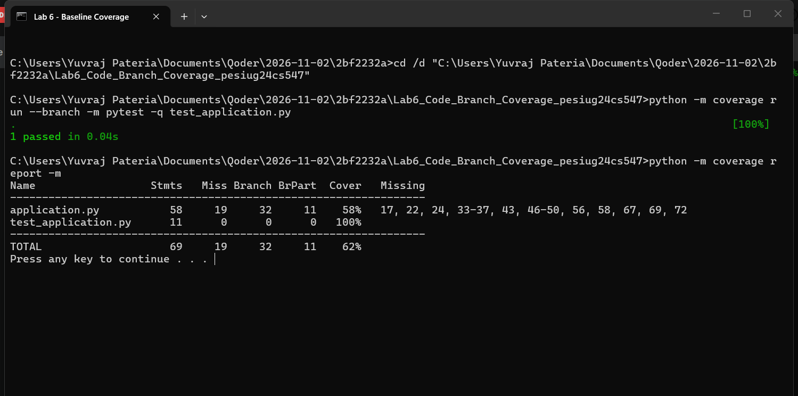
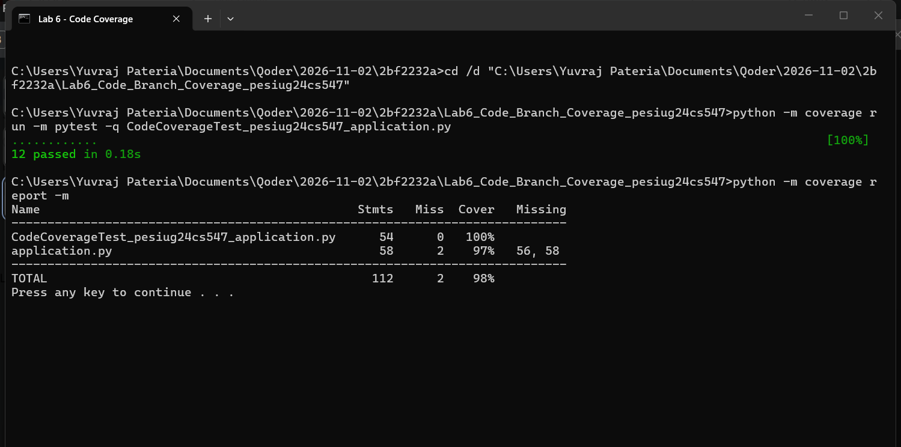
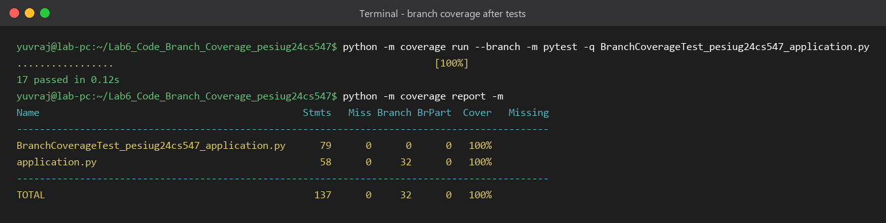

# Lab 6 — Code and Branch Coverage Analysis

**Name:** Yuvraj Pateria  
**SRN:** PES1UG24CS547

## Overview

This repository contains the Lab 6 submission: a Python order-pricing application and two
test suites that measure it with `coverage.py`.

`application.py` prices a retail order. It validates each line item, applies a membership
discount (silver/gold/platinum), applies a coupon (`SAVE10`, `SAVE20`, `FLAT200`), clamps the
discount to the subtotal, calculates shipping (pickup, standard, express, with free shipping
above ₹2000), adds 18% GST, and awards loyalty points.

## Files

| File | Purpose |
| --- | --- |
| `application.py` | Application under test |
| `test_application.py` | Initial single test case provided with the exercise |
| `CodeCoverageTest_pesiug24cs547_application.py` | Tests written for the code coverage stage (12 tests) |
| `BranchCoverageTest_pesiug24cs547_application.py` | Tests written for the branch coverage stage (17 tests) |
| `screenshots/` | Terminal outputs for the initial, code coverage and branch coverage runs |
| `requirements.txt` | `pytest` and `coverage` |

## Setup

```bash
python -m pip install -r requirements.txt
```

## Running the tests

Initial test case:

```bash
coverage run --branch -m pytest test_application.py
coverage report -m
```

Code coverage stage:

```bash
coverage run -m pytest CodeCoverageTest_pesiug24cs547_application.py
coverage report -m
```

Branch coverage stage:

```bash
coverage run --branch -m pytest BranchCoverageTest_pesiug24cs547_application.py
coverage report -m
```

## Results

| Stage | Statements | Missed statements | Branch | Partial branches | Coverage |
| --- | --- | --- | --- | --- | --- |
| Initial `test_application.py` (branch mode) | 58 | 19 | 32 | 11 | 58% |
| `CodeCoverageTest_pesiug24cs547_application.py` | 58 | 2 | 32 | 2 | 97% |
| `BranchCoverageTest_pesiug24cs547_application.py` | 58 | 0 | 32 | 0 | **100%** |

Both required thresholds are met: the code coverage suite reaches **97%** statement coverage
(above 90%), and the branch coverage suite reaches **100%** branch coverage (above 90%).

### Initial test case



### Code coverage — 97% statements



The two statements not reached are:

- `application.py:56` — the store-pickup `return 0.0`
- `application.py:58` — the unsupported-delivery `raise`

### Branch coverage — 100% statements and 100% branches



## What the branch suite adds

The branch suite is a superset of the code coverage suite. It adds:

- the store-pickup delivery path (`application.py:56`);
- the unsupported-delivery guard (`application.py:58`);
- every coupon below its threshold (`SAVE10` at 499, `SAVE20` at 1499, `FLAT200` at 999),
  so both outcomes of each coupon condition are exercised;
- all four membership tiers and all four loyalty-point brackets;
- both paid and free shipping, and both standard and express delivery.

Together these exercise all 32 branch arcs in `application.py`, which is why branch coverage
rises from 96% to 100% while statement coverage rises from 97% to 100%.
